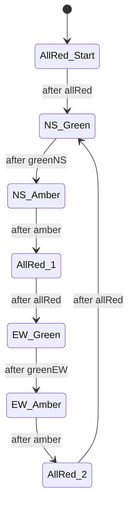
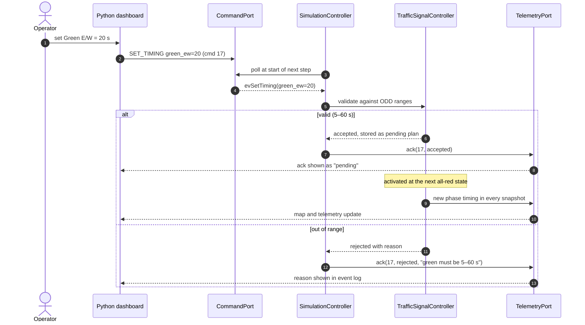

<div align="center">

# Smart Intersection: Autonomous Traffic Simulation

**2IN70 – Software Engineering for Autonomous Systems · TU/e · Group 7**

Andrei Boaca · Cosmin Nan


</div>

> **Problem statement.** Smart and conventional vehicles and pedestrians require safe,
> predictable, and efficient passage through a shared signalized intersection under
> varying traffic demand and traffic-light timing conditions.

A model-driven simulation of a signalized urban intersection. All traffic behaviour
— signal phases, vehicle and pedestrian agents, right-of-way and the simulation clock —
is an **executable SysML model in IBM Rhapsody**. A separate Python dashboard lets an
operator configure scenarios and watch the model run, but never decides anything itself.

**Quick links:** [Milestone 1 report (PDF)](docs/milestones/milestone-1.pdf) ·
[Design decisions](docs/decisions/) · [Development backlog](https://github.com/boacaandrei11/2in70group7/issues) ·
[Questions for feedback](#9-points-for-feedback)

> [!NOTE]
> **Project status (Week 2):** design baseline. Milestone 1 is submitted; the Rhapsody
> model and the dashboard are **not implemented yet**. Diagrams on this page describe the
> intended design and are marked *planned* where relevant.

---

## Contents

1. [Key design principles](#1-key-design-principles)
2. [System context](#2-system-context)
3. [Architecture](#3-architecture)
4. [Intersection and operational design domain](#4-intersection-and-operational-design-domain)
5. [Behaviour](#5-behaviour)
6. [Operator dashboard concept](#6-operator-dashboard-concept)
7. [Stakeholders and conflicts](#7-stakeholders-and-conflicts)
8. [Development plan](#8-development-plan)
9. [Points for feedback](#9-points-for-feedback)
10. [Repository](#10-repository)

---

## 1. Key design principles

| | Principle | Why |
|---|---|---|
| 🧠 | **Rhapsody is the source of truth.** Every signal change, vehicle move and right-of-way decision happens in the executable model. | Behaviour is traceable to the SysML model and visible in Rhapsody animation. |
| 📨 | **The UI only requests.** Configuration changes are commands the model validates, applies at a safe phase boundary, and acknowledges. | A new timing plan can never create conflicting greens or cut a clearance interval (conflict C3). |
| 👁️ | **Ground truth ≠ observation.** A smart vehicle acts on what it *perceives*, stored separately from the commanded signal state. | Missed or uncertain detections can be tested instead of hidden (conflict C4). |
| 🔁 | **Reproducible runs.** Fixed simulation step, scenario files and a random seed. | Two runs that differ in one parameter (e.g. green time) can be compared. |
| 🧩 | **Grow in gates.** Prove each integration step before adding features; ML perception is a separate, optional extension. | Keeps the core verifiable and the demo reliable. |

---

## 2. System context

The **system of interest** is the black-box block `SmartIntersectionCore`. Vehicles and
pedestrians are simulated agents *inside* it; the operator, the Python dashboard, the
test harness and the (planned) ML perception service are outside.

<p align="center"></p>

| External actor / system | Input to the SOI | Output from the SOI |
|---|---|---|
| Python dashboard (used by the operator) | scenario selection, requested signal durations, traffic population and speeds, start / pause / reset | command accept / reject, simulation time, signal indications, agent positions, speeds and states, events and warnings |
| Scenario / test harness | geometry and routes, repeatable scenario inputs, stimuli, random seed | traces, events, observed states, run identifiers |
| ML perception service *(planned)* | time-stamped detections: class, light indication, confidence, optional location | acknowledgement and diagnostics |

---

## 3. Architecture

<p align="center"></p>

| Part | Responsible for | Not responsible for |
|---|---|---|
| **Rhapsody model** (`SmartIntersectionCore`) | state machines for signals and agents, movement updates, command validation, simulation clock, reaction to perception events | drawing, object-detection inference |
| **Ports + `bridge/`** (C++) | serialising snapshots, receiving commands, turning them into model events | any traffic decision |
| **Python dashboard** | configuration, telemetry and map views; sending requests; showing acknowledged state | an independent timer or truth for signals or vehicle motion |
| **ML perception service** *(stretch)* | detections with class, bounding box, confidence, light state | actuating signals or vehicles |

**Execution approach (proposed, to be confirmed by the proof of concept):** one
`SimulationController` owns a fixed time step (dt = 0.1 s). Each step it reads pending
commands, updates the signal controller and all agents, then publishes one state
snapshot. Messages are JSON over local UDP; the draft contract is in
[`protocol/`](protocol/). Rationale: [decision 0002](docs/decisions/0002-model-structure-and-execution.md).

---

## 4. Intersection and operational design domain

<p align="center"></p>

| ODD aspect | Baseline assumption (Milestone 1) |
|---|---|
| Road geometry | one four-arm signalized intersection, right-hand traffic, one lane in / out per arm, stop lines and one zebra crossing per arm |
| Road users | ≤ 4 vehicles (one smart, rest conventional) and 2–6 pedestrians at once |
| Movement | straight-through only (no turning, overtaking or reversing); vehicles 0–8.5 m/s, pedestrians 0.8–1.8 m/s |
| Traffic lights | two mutually exclusive vehicle groups (N/S, E/W) with amber and all-red transitions and protected pedestrian permissions |
| Configurable timings | green 5–60 s · amber 2–5 s · all-red 1–3 s · pedestrian walk 5–30 s; pedestrian clearance ≥ crossing length / 0.8 m/s |
| Environment | daylight, dry road, full visibility; rain, fog, roadworks, emergency vehicles and physical sensor/network failures excluded |
| Perception | idealized observations first; ML errors, delays and misses only in later experiments with camera-like images |
| Deployment | software-only simulation, no connection to real vehicles or infrastructure |

---

## 5. Behaviour

### Traffic signal controller *(planned state machine)*

Two vehicle phase groups with amber and all-red clearance between them. Timing values
are attributes of the block, so the same state machine runs any validated plan.



A pending timing plan becomes active only in an `AllRed` state, so a change can never
interrupt a green, amber or pedestrian clearance interval.

### Changing a timing plan at runtime *(planned interaction)*



### Safety checks derived from the ODD

| ID | Check |
|---|---|
| T1 | At no step are N/S and E/W vehicle signals green together, or a pedestrian walk permitted with a conflicting vehicle movement. |
| T2 | A vehicle approaching with sufficient stopping distance never crosses its stop line during red. |
| T3 | Invalid signal durations are rejected; a valid in-run change never interrupts an active clearance interval. |
| T4 | Repeating a scenario with the same arrivals but a different green time gives recorded, comparable phase, queue and waiting-time traces. |
| T5 *(later)* | Missing or low-confidence perception is never interpreted as a confirmed green or a clear crossing. |

---

## 6. Operator dashboard concept

One Python application with three panels: **telemetry** (why the model does what it does),
the **top-down map** (vehicles as rectangles, pedestrians as ✕), and **configuration**
(requests that the model validates). For the live demo, the Rhapsody animated state
machines run next to it.

<p align="center"></p>

*Concept wireframe — values are illustrative.* Note the telemetry panel shows the
**commanded** and **observed** light separately for the selected smart vehicle.

---

## 7. Stakeholders and conflicts

| Stakeholder | Main concerns | Conflicts |
|---|---|---|
| Pedestrians, incl. vulnerable users | protected crossings, sufficient clearance time, predictable vehicles | C1, C2 |
| Smart-vehicle users / developers | safe, understandable stop / yield / proceed decisions | C1, C4 |
| Conventional drivers | unambiguous signals, predictable priorities, reasonable journey time | C1, C2 |
| Road / traffic authority | valid signal plans, enforceable priorities, acceptable throughput | C2, C3 |
| Scenario operator / researcher | change timing and demand, repeat and compare runs | C3 |
| Model developers / verification | deterministic, inspectable behaviour; evidence that safety holds | C3, C4 |

| ID | Conflict | Consequence for the model |
|---|---|---|
| C1 | cautious vehicles and pedestrian safety vs. short vehicle delays | safety and right-of-way rules take precedence over waiting time |
| C2 | longer pedestrian intervals vs. vehicle throughput | pedestrian and vehicle phases are explicit and independently testable |
| C3 | flexible timing changes vs. valid phase sequences and reproducibility | validate plans, apply at safe boundaries, record the active configuration |
| C4 | realistic ML perception vs. transparent, verifiable decisions | keep ground truth separate from observations; test idealized inputs first |

---

## 8. Development plan

### Model structure (course SysML packages)

```
SmartIntersection
├── Requirements    stakeholder needs · ODD · system and safety requirements
├── UseCases        actors · configure scenario · run intersection · inspect telemetry
├── Structure       SmartIntersectionCore · signals · agents · simulation · interfaces
├── Behaviour       activities · sequence diagrams
└── Verification    test cases traced to requirements · test harness
```

### Delivery gates

Each gate must work before the next one starts. Status is updated as work lands.

| Gate | Evidence of completion | Status |
|---|---|---|
| **G1** SysML structure | course-template project with the five packages, SOI block and context BDD | ⏳ next |
| **G2** Model behaviour | animated `TrafficSignalController` cycles through all phases with configured timings | ⏳ next |
| **G3** Rhapsody → Python | a model-owned signal state is shown in Python without a local timer | planned |
| **G4** Python → Rhapsody | a timing change is acknowledged and alters the next phase cycle | planned |
| **G5** Reproducibility | same scenario and seed reproduce the same event log | planned |
| **G6** Perception link | an idealized detection event triggers the right smart-vehicle transition | planned |
| **G7** ML perception | a detector produces plausible detections; the model logs confidence and action | stretch |

### Alignment with the course

| Week | Course topic | Planned model content |
|---|---|---|
| 1 | Context, SysML basics | system context, SOI, ODD — **Milestone 1 ✅** |
| 2 | Requirements engineering | use case and requirements diagrams with IDs |
| 3 | Process, safety, testing | test specification traced to requirements |
| 4 | Embedded / cyber-physical, state machines | signal, vehicle and pedestrian state machines; sequence diagrams |
| 5 | Software architecture | BDD / IBD, ports and interfaces, allocation |
| 6 | SDV E/E architectures | design alternatives and trade-offs |
| 7 | OSEK, AUTOSAR | mapping blocks to AUTOSAR software components |
| 8 | Presentations | final model, report and live demonstration |

---

## 9. Points for feedback

We would appreciate the lecturer's view on these before we start implementing:

1. **System boundary.** Is it acceptable that vehicles and pedestrians are simulated agents
   *inside* `SmartIntersectionCore`, with the dashboard and ML service outside?
2. **V2I communication.** Should a smart vehicle also receive signal phase and timing from
   the infrastructure (a simple C-ITS / V2I message), in addition to perception?
   It is not in Milestone 1; we would add it in the requirements.
3. **Executable model + external UI.** Is a Python dashboard connected to the
   Rhapsody-generated C++ (with animated state machines shown in Rhapsody) an acceptable
   demonstration setup, or should more of the interface live in Rhapsody itself?
4. **Scope and depth.** Is the baseline (one intersection, ≤ 4 vehicles, straight-through
   only, fixed-time control) enough, with turning, adaptive control and ML as extensions?
5. **Expected deliverables.** Which SysML diagrams and how much traceability are expected
   in the coming milestones, so we can model them in the order the course needs them?

---

## 10. Repository

| Folder | Contents |
|---|---|
| [`model/`](model/) | Rhapsody project — source of truth for behaviour |
| [`bridge/`](bridge/) | hand-written C++ used by the model's ports |
| [`protocol/`](protocol/) | draft message contract between the model and Python |
| [`viz/`](viz/) | Python dashboard |
| [`scenarios/`](scenarios/) · [`tests/`](tests/) | repeatable scenarios and verification test cases |
| [`docs/`](docs/) | milestone submissions, diagrams (SVG + PNG for the report), decision records |

Developer workflow and setup: [CONTRIBUTING.md](CONTRIBUTING.md).
