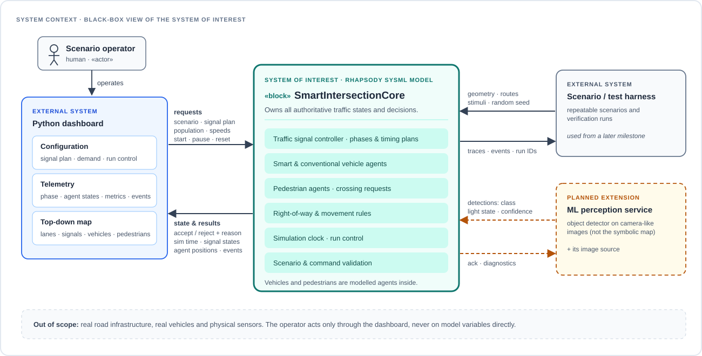
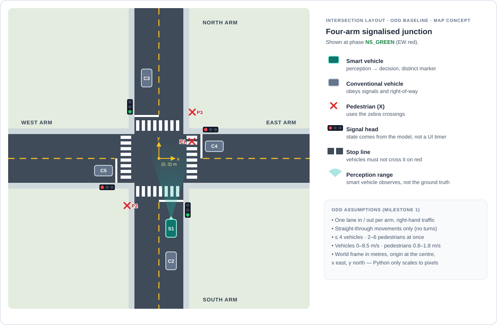
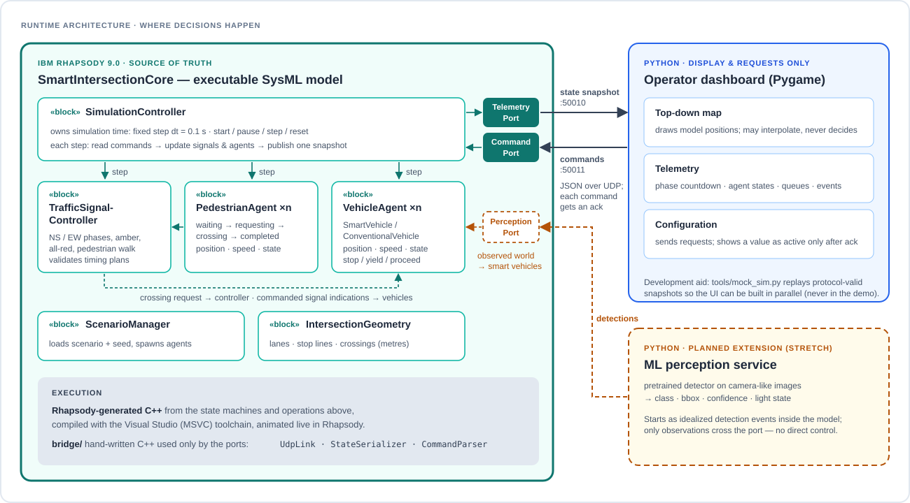
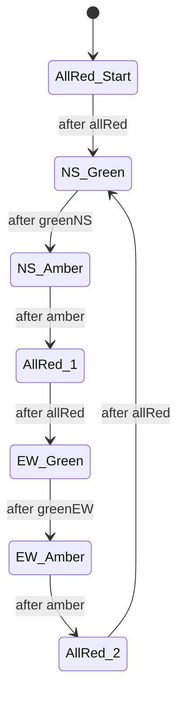
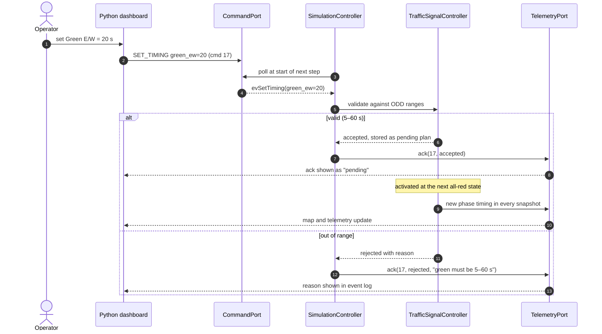
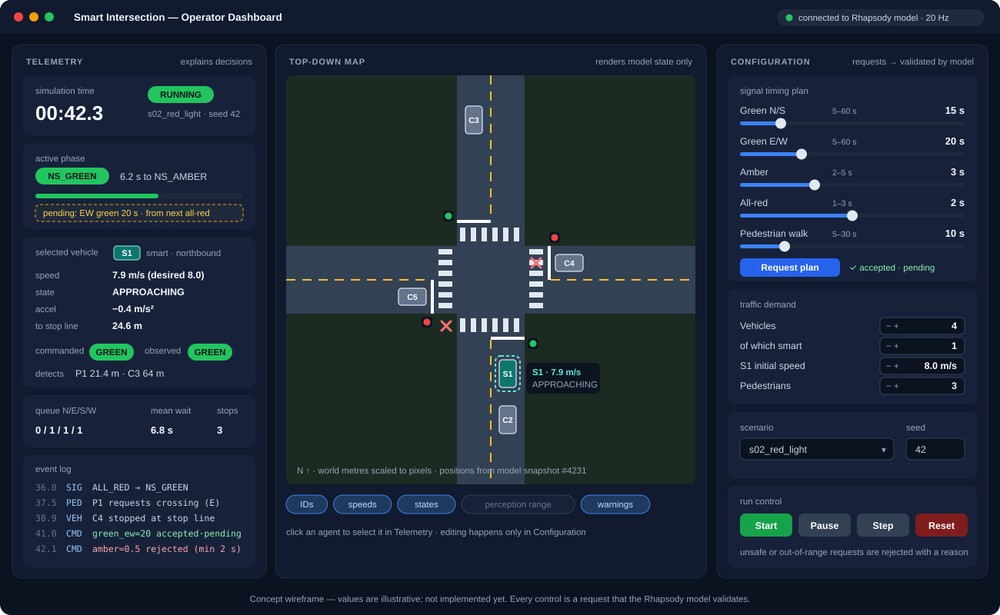

<div align="center">

# Smart Intersection: Autonomous Traffic Simulation

**2IN70 – Software Engineering for Autonomous Systems · TU/e · Group 7**

Andrei Boaca · Cosmin Nan


</div>

> **Problem statement.** Smart and conventional vehicles and pedestrians require safe,
> predictable, and efficient passage through a shared signalized intersection under
> varying traffic demand and traffic-light timing conditions.

A model-driven simulation of a signalized urban intersection. All traffic behaviour
— signal phases, vehicle and pedestrian agents, right-of-way and the simulation clock —
is an **executable SysML model in IBM Rhapsody**. A separate Python dashboard lets an
operator configure scenarios and watch the model run, but never decides anything itself.

**Quick links:** [Milestone 1 report (PDF)](docs/milestones/milestone-1.pdf) ·
[Design decisions](docs/decisions/) · [Development backlog](https://github.com/boacaandrei11/2in70group7/issues) ·
[Questions for feedback](#9-points-for-feedback)

> [!NOTE]
> **Project status (Week 2):** design baseline. Milestone 1 is submitted; the Rhapsody
> model and the dashboard are **not implemented yet**. Diagrams on this page describe the
> intended design and are marked *planned* where relevant.

---

## Contents

**Part A — Project definition and planning**
1. [Project overview](#1-project-overview)
2. [System context](#2-system-context)
3. [Operational design domain](#3-operational-design-domain)
4. [Stakeholders and conflicts](#4-stakeholders-and-conflicts)
5. [Requirements](#5-requirements)
6. [Project plan](#6-project-plan)
7. [Risks](#7-risks)
8. [Team and way of working](#8-team-and-way-of-working)
9. [Points for feedback](#9-points-for-feedback)

**Part B — Technical design** *(living section, grows as the model is built)*

10. [Architectural principles](#10-architectural-principles)
11. [Architecture](#11-architecture)
12. [Behaviour](#12-behaviour)
13. [Operator dashboard concept](#13-operator-dashboard-concept)
14. [Repository](#14-repository)

---

# Part A — Project definition and planning

## 1. Project overview

The **Smart Intersection Simulation System** is a model-driven simulation of a
signalized urban intersection shared by smart vehicles, conventional vehicles and
pedestrians. It investigates how traffic demand and configurable traffic-light timings
influence right-of-way decisions, waiting times and the movement of road users. Its
scope is a controlled software simulation, not the operation of a real intersection or
vehicle.

**Operational concept.** A scenario defines the road layout, the initial and arriving
vehicles and pedestrians, and a traffic-light timing plan. During a run, the model
updates signal phases and the states of all road users. Vehicles obey signal
indications and right-of-way rules; pedestrians use the designated crossings. The
smart vehicle has an explicit *perception → decision* interface, so its responses to
observed vehicles, pedestrians and signals can be studied separately from the simulated
ground truth. The operator can change timing plans within safety limits; changes are
validated and applied only at a safe phase boundary.

**What makes it an autonomous-systems project:** a sense–plan–act loop in the smart
vehicle, safety-critical signal logic with verifiable invariants, configurable
scenarios with reproducible runs, and a clear separation between the executable SysML
model (decisions) and the operator interface (requests and display).

**Planned extension.** A Python object detector could later provide detections from
camera-like images to the smart vehicle. It would only supply observations and is
not guaranteed to be implemented; the symbolic map is not suitable camera input.

---

## 2. System context

The **system of interest** is the black-box block `SmartIntersectionCore`. Vehicles and
pedestrians are simulated agents *inside* it; the operator, the Python dashboard, the
test harness and the (planned) ML perception service are outside.

<p align="center"></p>

| External actor / system | Input to the SOI | Output from the SOI |
|---|---|---|
| Python dashboard (used by the operator) | scenario selection, requested signal durations, traffic population and speeds, start / pause / reset | command accept / reject, simulation time, signal indications, agent positions, speeds and states, events and warnings |
| Scenario / test harness | geometry and routes, repeatable scenario inputs, stimuli, random seed | traces, events, observed states, run identifiers |
| ML perception service *(planned)* | time-stamped detections: class, light indication, confidence, optional location | acknowledgement and diagnostics |

---

## 3. Operational design domain

<p align="center"></p>

| ODD aspect | Baseline assumption (Milestone 1) |
|---|---|
| Road geometry | one four-arm signalized intersection, right-hand traffic, one lane in / out per arm, stop lines and one zebra crossing per arm |
| Road users | ≤ 4 vehicles (one smart, rest conventional) and 2–6 pedestrians at once |
| Movement | straight-through only (no turning, overtaking or reversing); vehicles 0–8.5 m/s, pedestrians 0.8–1.8 m/s |
| Traffic lights | two mutually exclusive vehicle groups (N/S, E/W) with amber and all-red transitions and protected pedestrian permissions |
| Configurable timings | green 5–60 s · amber 2–5 s · all-red 1–3 s · pedestrian walk 5–30 s; pedestrian clearance ≥ crossing length / 0.8 m/s |
| Environment | daylight, dry road, full visibility; rain, fog, roadworks, emergency vehicles and physical sensor/network failures excluded |
| Perception | idealized observations first; ML errors, delays and misses only in later experiments with camera-like images |
| Deployment | software-only simulation, no connection to real vehicles or infrastructure |

---

## 4. Stakeholders and conflicts

Because the system of interest is a **simulation**, we separate *domain* stakeholders
(whose interests the model must represent correctly) from stakeholders of the
*simulation itself* (who use, build or depend on it).

| Group | Stakeholder | Main concerns | Measure / indicator | Priority | Conflicts |
|---|---|---|---|---|---|
| Domain | Pedestrians, incl. vulnerable users | protected crossing, sufficient clearance time, predictable vehicles | walk + clearance time, maximum waiting time, zero conflicting permissions | high | C1, C2 |
| Domain | Smart-vehicle occupants | safe, smooth and understandable vehicle behaviour | no red-light violations, braking within limits, number of stops | high | C1 |
| Domain | Conventional drivers | unambiguous signals, fair priority, reasonable delay | mean delay, queue length | medium | C1, C2 |
| Domain | Road / traffic authority | valid signal plans, safe operation, acceptable throughput | no conflicting greens, vehicles per cycle | high | C2, C3 |
| Simulation | Scenario operator / researcher | configure timing and demand, repeat and compare runs | identical traces for the same scenario and seed | medium | C3 |
| Simulation | Smart-vehicle developers | clear perception → decision interface, testable decisions | perceived and true state logged, each decision traceable | medium | C4 |
| Simulation | Course team (ourselves) — modelling, implementation and verification | deterministic, inspectable model; SysML compliance; traceability; manageable complexity; reliable demo | requirements traced to tests, test pass rate, model executes in Rhapsody | high | C3, C4 |

**Considered and excluded from the baseline**

| Stakeholder | Why excluded |
|---|---|
| Cyclists | not in the ODD road-user set (vehicles and pedestrians only) |
| Emergency services | priority / pre-emption for emergency vehicles is excluded from the ODD |
| Public transport operators | no bus or tram priority in the baseline signal plan |
| Insurance companies | liability and risk assessment of real incidents; no real vehicles are involved |
| Vehicle OEMs | no production vehicle software or hardware; the smart vehicle is a modelled agent |
| Infrastructure manager | owns and maintains physical signal hardware, which is outside the software-only scope |
| V2X / telecom network provider | no physical communication network; any V2I exchange would be simulated |
| Police / traffic enforcement | enforcement of violations is not modelled; violations are only logged |
| Local residents | noise, emissions and land use are not evaluated |

**Conflicts between stakeholder concerns**

| ID | Conflict | Consequence for the model |
|---|---|---|
| C1 | cautious vehicles and pedestrian safety vs. short vehicle delays | safety and right-of-way rules take precedence over waiting time |
| C2 | longer pedestrian intervals vs. vehicle throughput | pedestrian and vehicle phases are explicit and independently testable |
| C3 | flexible timing changes vs. valid phase sequences and reproducibility | validate plans, apply at safe boundaries, record the active configuration |
| C4 | realistic ML perception vs. transparent, verifiable decisions | keep ground truth separate from observations; test idealized inputs first |

---

## 5. Requirements

> [!IMPORTANT]
> **Draft v0.1** derived from Milestone 1 (stakeholders, conflicts C1–C4, ODD and checks
> T1–T5). In Week 2 these will be refined and entered in the Rhapsody `Requirements`
> package, where each one is traced to model elements and test cases.
> Priority: **M** must · **S** should · **C** could.

### 5.1 Functional requirements

| ID | The system shall … | Source | Prio |
|---|---|---|---|
| **F-01** | control the vehicle signals of two mutually exclusive movement groups (N/S, E/W) in the sequence green → amber → all-red → other group green. | road authority, ODD | M |
| **F-02** | grant pedestrian walk permission on a crossing only while no conflicting vehicle movement has permission. | pedestrians, C2 | M |
| **F-03** | accept crossing requests from pedestrian agents and serve each request in the next phase in which that crossing can be released. | pedestrians | M |
| **F-04** | accept operator requests to change the green (per group), amber, all-red and pedestrian walk durations. | operator, C3 | M |
| **F-05** | reject timing requests outside the ODD ranges (green 5–60 s, amber 2–5 s, all-red 1–3 s, walk 5–30 s) and report the reason. | road authority, C3 | M |
| **F-06** | activate an accepted timing plan only at the next all-red state, never during green, amber or a pedestrian clearance interval. | road authority, C3 | M |
| **F-07** | update the position and speed of every vehicle agent each simulation step, within 0–8.5 m/s and modelled acceleration and braking limits. | ODD | M |
| **F-08** | make vehicle agents stop before the stop line on red, and on amber when stopping is feasible, and proceed on green when the path is clear. | drivers, occupants, C1 | M |
| **F-09** | move pedestrian agents across a crossing at 0.8–1.8 m/s, starting only with walk permission. | pedestrians, ODD | M |
| **F-10** | base the smart vehicle's stop / yield / proceed decision on its *observed* state of signals, vehicles and pedestrians, kept separate from the ground truth. | smart-vehicle developers, C4 | M |
| **F-11** | make the smart vehicle treat a missing or low-confidence signal observation as *not green*. | occupants, C4, T5 | S |
| **F-12** | load a scenario defining geometry, agents, arrivals, timing plan and random seed. | operator | M |
| **F-13** | support start, pause, single step and reset of a run. | operator | M |
| **F-14** | publish every step a snapshot with simulation time, active phase, signal states and the id, type, position, speed and state of every agent. | operator | M |
| **F-15** | acknowledge every operator command as accepted or rejected, with a reason when rejected. | operator, C3 | M |
| **F-16** | log time-stamped events: phase changes, commands, stops at stop lines, crossing requests and completions, safety-rule violations. | course team, authority | M |
| **F-17** | compute per run: waiting time per agent, queue length per arm and number of vehicle stops. | operator, authority | S |
| **F-18** | accept detection events (class, light state, confidence) from an external perception service through the perception interface. | smart-vehicle developers | C |

### 5.2 Non-functional requirements

| ID | Category | Requirement | Source | Prio |
|---|---|---|---|---|
| **NF-01** | Safety | At no simulation step shall conflicting movements (N/S and E/W vehicles, or a vehicle group and a conflicting pedestrian crossing) have permission at the same time. | pedestrians, authority, T1 | M |
| **NF-02** | Safety | A vehicle agent with sufficient stopping distance shall never cross its stop line during red. | occupants, authority, T2 | M |
| **NF-03** | Reproducibility | Running the same scenario with the same seed and timing plan shall produce an identical event log. | operator, course team, T4 | M |
| **NF-04** | Authority | All traffic decisions shall be made in the executable Rhapsody model; external components may change model state only through validated commands. | course team, C3 | M |
| **NF-05** | Timing | The model shall run with a fixed simulation step (proposed dt = 0.1 s) and publish state at ≥ 10 Hz in real-time mode. | operator | S |
| **NF-06** | Responsiveness | A state change in the model shall be visible in the dashboard within 200 ms. | operator | S |
| **NF-07** | Robustness | Closing, restarting or sending a malformed message from the dashboard shall not stop or corrupt the simulation. | course team | M |
| **NF-08** | Observability | During a run, the active states of the signal and agent state machines shall be visible through Rhapsody animation. | course team | M |
| **NF-09** | Usability | Every configuration control shall show its unit, accepted range, active vs pending value and any rejection reason. | operator | S |
| **NF-10** | Modifiability | The perception source (idealized ↔ ML) shall be replaceable without changing the smart vehicle's decision logic. | smart-vehicle developers, C4 | S |
| **NF-11** | Interoperability | All messages between the model and external tools shall follow a versioned, documented schema. | course team | S |
| **NF-12** | Traceability | Every requirement shall be traced to at least one model element and one test case. | course team | M |
| **NF-13** | Environment | The system shall run on a single Windows laptop with Rhapsody 9.0, the MSVC toolchain and Python 3, using only localhost communication. | course team | M |

### 5.3 Acceptance checks (from Milestone 1)

| ID | Check | Verifies |
|---|---|---|
| T1 | At no step are N/S and E/W vehicle signals green together, or a pedestrian walk permitted with a conflicting vehicle movement. | NF-01, F-02 |
| T2 | A vehicle approaching with sufficient stopping distance never crosses its stop line during red. | NF-02, F-08 |
| T3 | Invalid signal durations are rejected; a valid in-run change never interrupts an active clearance interval. | F-05, F-06 |
| T4 | Repeating a scenario with the same arrivals but a different green time gives recorded, comparable phase, queue and waiting-time traces. | NF-03, F-16, F-17 |
| T5 *(later)* | Missing or low-confidence perception is never interpreted as a confirmed green or a clear crossing. | F-10, F-11 |

---

## 6. Project plan

### 6.1 Model structure (course SysML packages)

```
SmartIntersection
├── Requirements    stakeholder needs · ODD · functional, non-functional and safety requirements
├── UseCases        actors · configure scenario · run intersection · inspect telemetry · evaluate run
├── Structure       SmartIntersectionCore · signals · agents · simulation · interfaces · value types
├── Behaviour       activities · sequence diagrams
└── Verification    test cases traced to requirements · test harness
```

### 6.2 Delivery gates

Each gate must work before the next one starts. Status is updated as work lands.

| Gate | Evidence of completion | Status |
|---|---|---|
| **G1** SysML structure | course-template project with the five packages, SOI block and context BDD | ⏳ next |
| **G2** Model behaviour | animated `TrafficSignalController` cycles through all phases with configured timings | ⏳ next |
| **G3** Rhapsody → Python | a model-owned signal state is shown in Python without a local timer | planned |
| **G4** Python → Rhapsody | a timing change is acknowledged and alters the next phase cycle | planned |
| **G5** Reproducibility | same scenario and seed reproduce the same event log | planned |
| **G6** Perception link | an idealized detection event triggers the right smart-vehicle transition | planned |
| **G7** ML perception | a detector produces plausible detections; the model logs confidence and action | stretch |

### 6.3 Alignment with the course

| Week | Course topic | Planned model content |
|---|---|---|
| 1 | Context, SysML basics | system context, SOI, ODD — **Milestone 1 ✅** |
| 2 | Requirements engineering | use case and requirements diagrams with IDs (section 5) |
| 3 | Process, safety, testing | test specification traced to requirements |
| 4 | Embedded / cyber-physical, state machines | signal, vehicle and pedestrian state machines; sequence diagrams |
| 5 | Software architecture | BDD / IBD, ports and interfaces, allocation |
| 6 | SDV E/E architectures | design alternatives and trade-offs |
| 7 | OSEK, AUTOSAR | mapping blocks to AUTOSAR software components |
| 8 | Presentations | final model, report and live demonstration |

The detailed backlog is tracked as [GitHub issues](https://github.com/boacaandrei11/2in70group7/issues).

---

## 7. Risks

| ID | Risk | Likelihood | Impact | Mitigation |
|---|---|---|---|---|
| R1 | Rhapsody 9.0 C++ code generation, build or animation does not work with the installed toolchain | medium | high | prove it first (G1–G2) on a one-block model before building anything else |
| R2 | Generated code cannot exchange data with an external process | medium | high | isolate network code in two ports and `bridge/`; prove both directions early (G3–G4) |
| R3 | Model files conflict when both members edit them | medium | medium | one unit file per package, one editor per package at a time, no automatic merges |
| R4 | Scope grows (ML, turning, V2I) before the core works | high | medium | gates: extensions start only after G5 |
| R5 | Real-time animation makes long scenarios slow to run | low | medium | configurable step period; batch runs without animation for verification |
| R6 | Project time competes with exam preparation | medium | medium | model each week's lecture topic directly, so report content grows with the model |

---

## 8. Team and way of working

| | |
|---|---|
| **Team** | Andrei Boaca, Cosmin Nan — both currently responsible for all areas; tasks are split per issue as work starts |
| **Planning** | GitHub issues per gate, ordered by the plan above |
| **Changes** | one branch per piece of work, merged by pull request after review by the other member |
| **Model edits** | one person per Rhapsody package at a time, announced before starting |
| **Feedback** | model shown at each weekly hands-on session |
| **Report** | Overleaf, following the course structure; diagrams exported from this repository |
| **Milestones** | submitted PDFs stored in [`docs/milestones/`](docs/milestones/) and tagged in git |

---

## 9. Points for feedback

We would appreciate the lecturer's view on these before we start implementing:

1. **System boundary.** Is it acceptable that vehicles and pedestrians are simulated agents
   *inside* `SmartIntersectionCore`, with the dashboard and ML service outside?
2. **Requirements.** Are the draft functional and non-functional requirements (section 5)
   at the right level of detail, and is the stakeholder split (domain vs simulation) useful?
3. **V2I communication.** Should a smart vehicle also receive signal phase and timing from
   the infrastructure (a simple C-ITS / V2I message), in addition to perception?
   It is not in Milestone 1; we would add it to the requirements.
4. **Executable model + external UI.** Is a Python dashboard connected to the
   Rhapsody-generated C++ (with animated state machines shown in Rhapsody) an acceptable
   demonstration setup, or should more of the interface live in Rhapsody itself?
5. **Scope and depth.** Is the baseline (one intersection, ≤ 4 vehicles, straight-through
   only, fixed-time control) enough, with turning, adaptive control and ML as extensions?
6. **Expected deliverables.** Which SysML diagrams and how much traceability are expected
   in the coming milestones, so we can model them in the order the course needs them?

---

# Part B — Technical design

> [!NOTE]
> This part describes the **intended** design. It is updated as each gate is completed;
> anything not yet built is marked *planned* or *proposed*.

## 10. Architectural principles

| | Principle | Why |
|---|---|---|
| 🧠 | **Rhapsody is the source of truth.** Every signal change, vehicle move and right-of-way decision happens in the executable model. | Behaviour is traceable to the SysML model and visible in Rhapsody animation. |
| 📨 | **The UI only requests.** Configuration changes are commands the model validates, applies at a safe phase boundary, and acknowledges. | A new timing plan can never create conflicting greens or cut a clearance interval (conflict C3). |
| 👁️ | **Ground truth ≠ observation.** A smart vehicle acts on what it *perceives*, stored separately from the commanded signal state. | Missed or uncertain detections can be tested instead of hidden (conflict C4). |
| 🔁 | **Reproducible runs.** Fixed simulation step, scenario files and a random seed. | Two runs that differ in one parameter (e.g. green time) can be compared. |
| 🧩 | **Grow in gates.** Prove each integration step before adding features; ML perception is a separate, optional extension. | Keeps the core verifiable and the demo reliable. |

---

## 11. Architecture

<p align="center"></p>

| Part | Responsible for | Not responsible for |
|---|---|---|
| **Rhapsody model** (`SmartIntersectionCore`) | state machines for signals and agents, movement updates, command validation, simulation clock, reaction to perception events | drawing, object-detection inference |
| **Ports + `bridge/`** (C++) | serialising snapshots, receiving commands, turning them into model events | any traffic decision |
| **Python dashboard** | configuration, telemetry and map views; sending requests; showing acknowledged state | an independent timer or truth for signals or vehicle motion |
| **ML perception service** *(stretch)* | detections with class, bounding box, confidence, light state | actuating signals or vehicles |

**Execution approach (proposed, to be confirmed by the proof of concept):** one
`SimulationController` owns a fixed time step (dt = 0.1 s). Each step it reads pending
commands, updates the signal controller and all agents, then publishes one state
snapshot. Messages are JSON over local UDP; the draft contract is in
[`protocol/`](protocol/). Rationale: [decision 0002](docs/decisions/0002-model-structure-and-execution.md).

---

## 12. Behaviour

### Traffic signal controller *(planned state machine)*

Two vehicle phase groups with amber and all-red clearance between them. Timing values
are attributes of the block, so the same state machine runs any validated plan.



A pending timing plan becomes active only in an `AllRed` state, so a change can never
interrupt a green, amber or pedestrian clearance interval.

### Changing a timing plan at runtime *(planned interaction)*



---

## 13. Operator dashboard concept

One Python application with three panels: **telemetry** (why the model does what it does),
the **top-down map** (vehicles as rectangles, pedestrians as ✕), and **configuration**
(requests that the model validates). For the live demo, the Rhapsody animated state
machines run next to it.

<p align="center"></p>

*Concept wireframe — values are illustrative.* Note the telemetry panel shows the
**commanded** and **observed** light separately for the selected smart vehicle.

---

## 14. Repository

| Folder | Contents |
|---|---|
| [`model/`](model/) | Rhapsody project — source of truth for behaviour |
| [`bridge/`](bridge/) | hand-written C++ used by the model's ports |
| [`protocol/`](protocol/) | draft message contract between the model and Python |
| [`viz/`](viz/) | Python dashboard |
| [`scenarios/`](scenarios/) · [`tests/`](tests/) | repeatable scenarios and verification test cases |
| [`docs/`](docs/) | milestone submissions, diagrams (SVG + PNG for the report), decision records |

Developer workflow and setup: [CONTRIBUTING.md](CONTRIBUTING.md).
