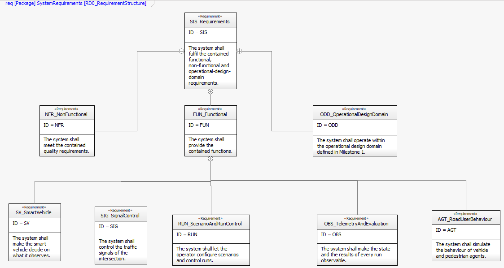
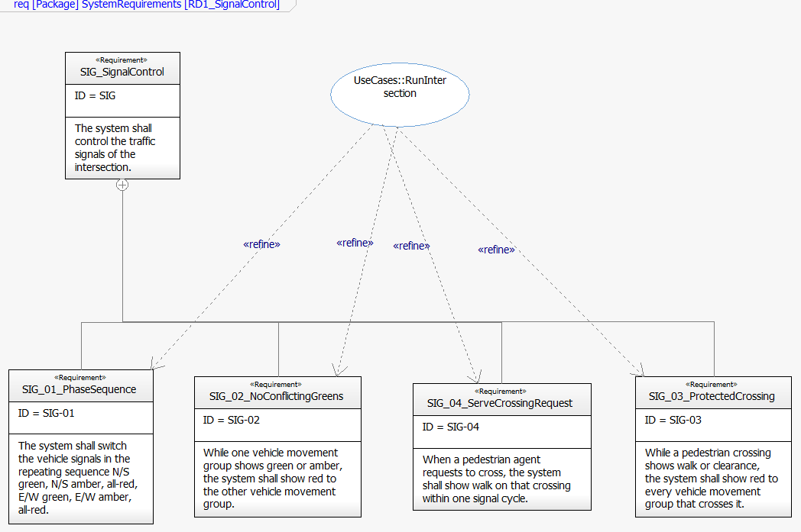
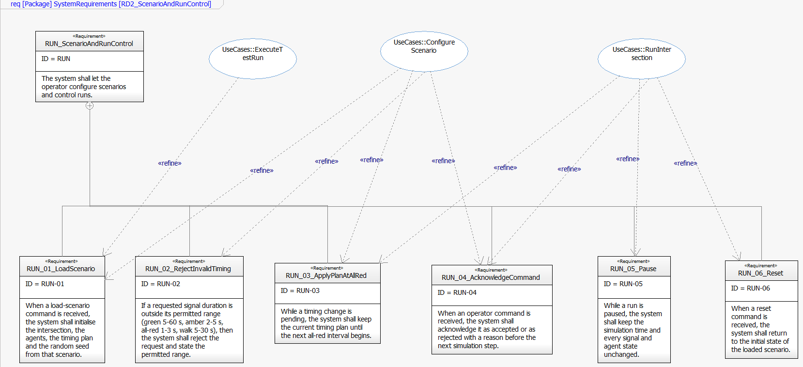
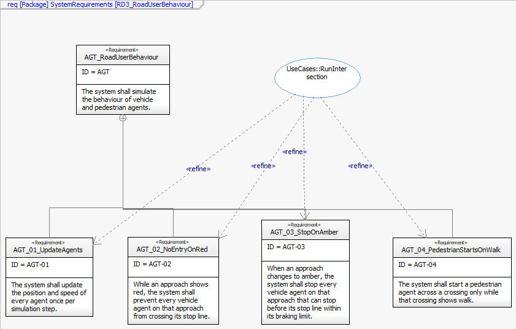
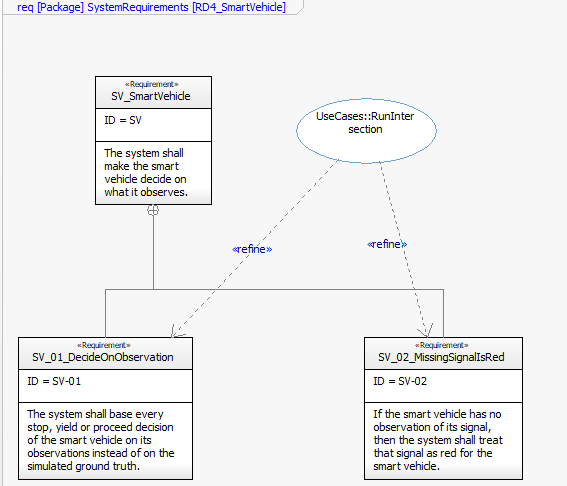
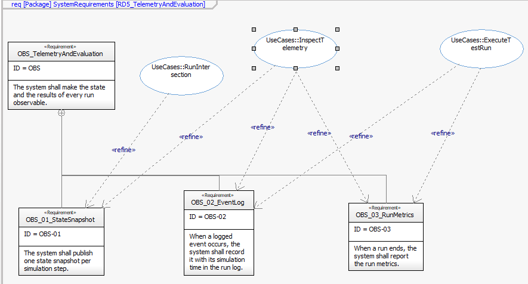
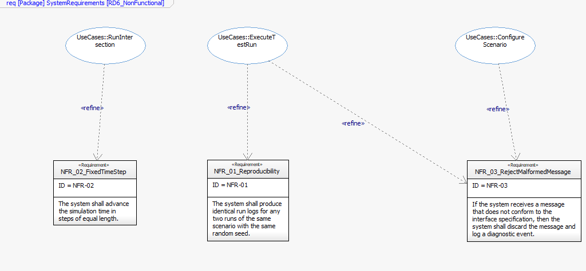
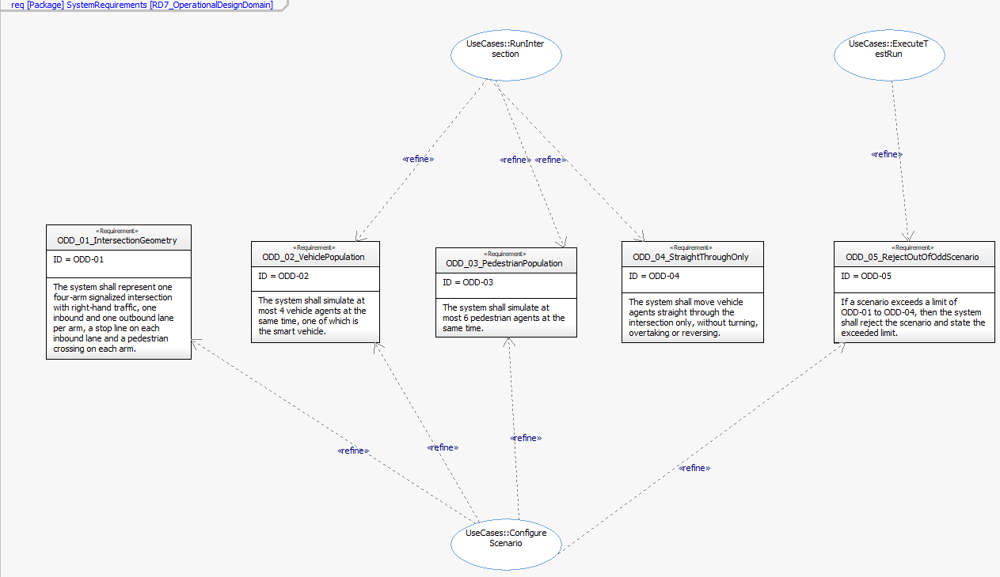

# System requirements — v1.1

*Smart Intersection Simulation System · 2IN70 Group 7 · 2026-11-20 · Milestone 2*

> [!NOTE]
> Generated from [`tools/requirements/requirements.json`](../tools/requirements/requirements.json) by `tools/requirements/render.py` — edit the JSON, not this file. The same JSON is loaded into the Rhapsody `Requirements` package by `tools/requirements/rhapsody_import.py`.

## Conventions

- **Subject.** In every requirement, 'the system' is the system of interest, the block SmartIntersectionCore.
- **Syntax.** Every requirement follows one EARS template: *Ubiquitous* (The system shall …), *State-driven* (While …, the system shall …), *Event-driven* (When …, the system shall …), *Unwanted behaviour* (If …, then the system shall …), *Optional feature* (Where …, the system shall …) or *Complex* (While …, when …, the system shall …). Exactly one *shall* per requirement; no *should / will / may*; units are SI.
- **Priority (MoSCoW).** M = must, S = should, C = could.
- **Verification.** Test, Analysis, Inspection or Demonstration.
- **Source.** Stakeholder (Milestone 1, revised 16 Nov), check T1–T5 and conflict C1–C4 the requirement comes from.
- **Refined by.** Use cases that refine the requirement with «refine» in the Rhapsody model.
- **Singular.** Lists (snapshot content, logged events, run metrics) are defined once below, so each requirement states one thing.

### Definitions

| Term | Meaning |
|---|---|
| *the system* | the system of interest, block SmartIntersectionCore |
| *vehicle movement group* | the vehicles of the N/S arms or of the E/W arms, which receive the same signal |
| *approach* | the inbound lane of one arm with its stop line and vehicle signal |
| *walk / clearance* | pedestrian signal states in which pedestrians may start / may finish crossing |
| *timing plan* | the durations of green per group, amber, all-red and walk |
| *simulation step* | one fixed increment of simulation time in which all signals and agents are updated |
| *state snapshot* | simulation time, active phase, every signal indication, and id, type, position, speed and state of every agent |
| *logged event* | phase change, operator command, vehicle stop at a stop line, crossing request, crossing completion or safety-rule violation |
| *run metrics* | waiting time of every agent, maximum queue length per arm and number of vehicle stops |
| *observation* | what the smart vehicle perceives of signals, vehicles and pedestrians, as opposed to the simulated ground truth |

**27 requirements:** 19 functional, 3 non-functional, 5 ODD · 4 unwanted-behaviour · 18 M / 8 S / 1 C.

## Use cases

| ID | Use case | Primary actor | Actor's goal |
|---|---|---|---|
| UC1 | ConfigureScenario | ScenarioOperator | Set up a scenario (traffic demand, road users, signal timing) that the system accepts as valid. |
| UC2 | RunIntersection | ScenarioOperator | Start, pause and reset a run in which the system moves road users and switches signals safely. |
| UC3 | InspectTelemetry | ScenarioOperator | Understand what the simulation is doing and why, from live state, events and metrics. |
| UC4 | ExecuteTestRun | ScenarioTestHarness | Run a scenario repeatably and obtain traces and results for verification. |
| UC5 | SubmitPerceptionDetections | MLPerceptionService | Deliver observations to the smart vehicle (planned extension; no requirements yet). |

## Requirement structure (containment)



```
SIS  System requirements (SmartIntersectionCore)
├── FUN  Functional requirements
│   ├── SIG  Traffic signal control  (SIG-01 … SIG-04)
│   ├── RUN  Scenario and run control  (RUN-01 … RUN-06)
│   ├── AGT  Road-user behaviour  (AGT-01 … AGT-04)
│   ├── SV   Smart-vehicle perception and decision  (SV-01 … SV-02)
│   └── OBS  Telemetry and evaluation  (OBS-01 … OBS-03)
├── NFR  Non-functional requirements  (NFR-01 … NFR-03)
└── ODD  Operational design domain  (ODD-01 … ODD-05)
```

## SIG — Traffic signal control



| ID | EARS | Requirement | Rationale | Source | Prio | Verif. | Refined by |
|---|---|---|---|---|---|---|---|
| **SIG-01** | Ubiquitous | The system shall switch the vehicle signals in the repeating sequence N/S green, N/S amber, all-red, E/W green, E/W amber, all-red. | This is the signal plan of the ODD: two mutually exclusive movement groups, separated by amber and all-red. | Road authority; conventional drivers | M | Test | UC2 |
| **SIG-02** | State-driven | While one vehicle movement group shows green or amber, the system shall show red to the other vehicle movement group. | Main safety rule: crossing traffic streams never have permission at the same time. | Road authority; occupants; drivers; check T1 | M | Test | UC2 |
| **SIG-03** | State-driven | While a pedestrian crossing shows walk or clearance, the system shall show red to every vehicle movement group that crosses it. | Pedestrians on a crossing are never in conflict with vehicles that have permission. | Pedestrians; road authority; check T1; conflict C1 | M | Test | UC2 |
| **SIG-04** | Event-driven | When a pedestrian agent requests to cross, the system shall show walk on that crossing within one signal cycle. | Pedestrians get a guaranteed crossing opportunity without disturbing the vehicle phase sequence. | Pedestrians; conflict C2 | S | Analysis | UC2 |

## RUN — Scenario and run control



| ID | EARS | Requirement | Rationale | Source | Prio | Verif. | Refined by |
|---|---|---|---|---|---|---|---|
| **RUN-01** | Event-driven | When a load-scenario command is received, the system shall initialise the intersection, the agents, the timing plan and the random seed from that scenario. | Everything that determines a run comes from one scenario, so runs can be repeated and compared. | Operator; course team; check T4 | M | Test | UC1, UC4 |
| **RUN-02** | Unwanted behaviour | If a requested signal duration is outside its permitted range (green 5–60 s, amber 2–5 s, all-red 1–3 s, walk 5–30 s), then the system shall reject the request and state the permitted range. | Out-of-range durations could make the signal plan unsafe; stating the range lets the operator correct the request. Ranges are those of the Milestone 1 ODD. | Road authority; operator; check T3; conflict C3 | M | Test | UC1 |
| **RUN-03** | State-driven | While a timing change is pending, the system shall keep the current timing plan until the next all-red interval begins. | A timing change can never cut short a green, amber or pedestrian interval that is already running. | Road authority; pedestrians; check T3; conflict C3 | M | Test | UC1, UC2 |
| **RUN-04** | Event-driven | When an operator command is received, the system shall acknowledge it as accepted or as rejected with a reason before the next simulation step. | The dashboard only requests changes and the model decides; the acknowledgement tells the operator what is actually in effect. | Operator; conflict C3 | S | Test | UC1, UC2 |
| **RUN-05** | State-driven | While a run is paused, the system shall keep the simulation time and every signal and agent state unchanged. | The operator can look at a situation in detail without it changing. | Operator | S | Demonstration | UC2 |
| **RUN-06** | Event-driven | When a reset command is received, the system shall return to the initial state of the loaded scenario. | The operator can repeat a run, e.g. with another timing plan, without loading the scenario again. | Operator / researcher | C | Test | UC2 |

## AGT — Road-user behaviour



| ID | EARS | Requirement | Rationale | Source | Prio | Verif. | Refined by |
|---|---|---|---|---|---|---|---|
| **AGT-01** | Ubiquitous | The system shall update the position and speed of every agent once per simulation step. | Agent motion belongs to the model, not to the dashboard, and advances in the same steps as the signals. | Course team | M | Test | UC2 |
| **AGT-02** | State-driven | While an approach shows red, the system shall prevent every vehicle agent on that approach from crossing its stop line. | Every vehicle, smart or conventional, obeys red. | Occupants; drivers; road authority; check T2; conflict C1 | M | Test | UC2 |
| **AGT-03** | Event-driven | When an approach changes to amber, the system shall stop every vehicle agent on that approach that can stop before its stop line within its braking limit. | Vehicles that can stop do so; vehicles too close to stop clear the intersection. The braking limit is a parameter of the vehicle model, defined in the behaviour model. | Occupants; drivers; check T2; conflict C1 | M | Test | UC2 |
| **AGT-04** | Ubiquitous | The system shall start a pedestrian agent across a crossing only while that crossing shows walk. | Pedestrians obey their signal, so together with SIG-03 they are always protected. | Pedestrians; conflict C1 | M | Test | UC2 |

## SV — Smart-vehicle perception and decision



| ID | EARS | Requirement | Rationale | Source | Prio | Verif. | Refined by |
|---|---|---|---|---|---|---|---|
| **SV-01** | Ubiquitous | The system shall base every stop, yield or proceed decision of the smart vehicle on its observations instead of on the simulated ground truth. | The smart vehicle behaves like a real automated vehicle, and errors between observation and reality become visible and testable. | Smart-vehicle developers; occupants; conflict C4 | M | Inspection | UC2 |
| **SV-02** | Unwanted behaviour | If the smart vehicle has no observation of its signal, then the system shall treat that signal as red for the smart vehicle. | Fail-safe: the smart vehicle never drives on a green it has not seen. | Occupants; pedestrians; check T5; conflict C4 | S | Test | UC2 |

## OBS — Telemetry and evaluation



| ID | EARS | Requirement | Rationale | Source | Prio | Verif. | Refined by |
|---|---|---|---|---|---|---|---|
| **OBS-01** | Ubiquitous | The system shall publish one state snapshot per simulation step. | The dashboard shows only state owned by the model; a full snapshot every step means a lost message is replaced by the next one. | Operator; course team | M | Test | UC3, UC2 |
| **OBS-02** | Event-driven | When a logged event occurs, the system shall record it with its simulation time in the run log. | The run log is the evidence for verification (checks T1–T4) and the basis for comparing runs. | Course team; road authority | M | Test | UC3, UC4 |
| **OBS-03** | Event-driven | When a run ends, the system shall report the run metrics. | Makes the trade-off between delay and safety of different timing plans measurable. | Operator / researcher; road authority; drivers; check T4; conflicts C1, C2 | S | Test | UC4, UC3 |

## NFR — Non-functional requirements



| ID | EARS | Requirement | Rationale | Source | Prio | Verif. | Refined by |
|---|---|---|---|---|---|---|---|
| **NFR-01** | Ubiquitous | The system shall produce identical run logs for any two runs of the same scenario with the same random seed. | A difference between two runs can then only come from the parameter that was changed. | Operator; course team; check T4; conflict C3 | M | Test | UC4 |
| **NFR-02** | Ubiquitous | The system shall advance the simulation time in steps of equal length. | Equal steps make the behaviour deterministic and independent of the computer speed (needed for NFR-01). | Course team | S | Inspection | UC2 |
| **NFR-03** | Unwanted behaviour | If the system receives a message that does not conform to the interface specification, then the system shall discard the message and log a diagnostic event. | Faulty input from the dashboard or the test harness must not stop or corrupt a run. | Course team; operator | S | Test | UC1, UC4 |

## ODD — Operational design domain



| ID | EARS | Requirement | Rationale | Source | Prio | Verif. | Refined by |
|---|---|---|---|---|---|---|---|
| **ODD-01** | Ubiquitous | The system shall represent one four-arm signalized intersection with right-hand traffic, one inbound and one outbound lane per arm, a stop line on each inbound lane and a pedestrian crossing on each arm. | Fixing the layout means every conflict between road users is known in advance and can be checked completely. | Road authority; course team | M | Inspection | UC1 |
| **ODD-02** | Ubiquitous | The system shall simulate at most 4 vehicle agents at the same time, one of which is the smart vehicle. | Enough vehicles for interaction between the smart vehicle and conventional vehicles, with a bounded test effort (Milestone 1 ODD). | Course team | M | Test | UC1, UC2 |
| **ODD-03** | Ubiquitous | The system shall simulate at most 6 pedestrian agents at the same time. | Enough pedestrians to load all four crossings, with a bounded test effort (Milestone 1 ODD). | Pedestrians; course team | S | Test | UC1, UC2 |
| **ODD-04** | Ubiquitous | The system shall move vehicle agents straight through the intersection only, without turning, overtaking or reversing. | Limits the conflicts to the two crossing movement groups; turning is a later extension. | Course team; road authority | M | Inspection | UC2 |
| **ODD-05** | Unwanted behaviour | If a scenario exceeds a limit of ODD-01 to ODD-04, then the system shall reject the scenario and state the exceeded limit. | Every run stays inside the domain for which the model is designed and verified. | Road authority; operator; course team; conflict C3 | M | Test | UC1, UC4 |

## Traceability: requirement ↔ use case («refine»)

| Req. | UC1 | UC2 | UC3 | UC4 | UC5 |
|---|---|---|---|---|---|
| SIG-01 |  | ● |  |  |  |
| SIG-02 |  | ● |  |  |  |
| SIG-03 |  | ● |  |  |  |
| SIG-04 |  | ● |  |  |  |
| RUN-01 | ● |  |  | ● |  |
| RUN-02 | ● |  |  |  |  |
| RUN-03 | ● | ● |  |  |  |
| RUN-04 | ● | ● |  |  |  |
| RUN-05 |  | ● |  |  |  |
| RUN-06 |  | ● |  |  |  |
| AGT-01 |  | ● |  |  |  |
| AGT-02 |  | ● |  |  |  |
| AGT-03 |  | ● |  |  |  |
| AGT-04 |  | ● |  |  |  |
| SV-01 |  | ● |  |  |  |
| SV-02 |  | ● |  |  |  |
| OBS-01 |  | ● | ● |  |  |
| OBS-02 |  |  | ● | ● |  |
| OBS-03 |  |  | ● | ● |  |
| NFR-01 |  |  |  | ● |  |
| NFR-02 |  | ● |  |  |  |
| NFR-03 | ● |  |  | ● |  |
| ODD-01 | ● |  |  |  |  |
| ODD-02 | ● | ● |  |  |  |
| ODD-03 | ● | ● |  |  |  |
| ODD-04 |  | ● |  |  |  |
| ODD-05 | ● |  |  | ● |  |

## Changes in v1.1 (after internal review)

- Fewer, sharper requirements (36 → 27); lists moved into the definitions so every requirement is singular.
- No numbers that are not in Milestone 1: speed limits, braking value, perception thresholds and step length removed. The only numbers left are the Milestone 1 ODD limits (agent counts, timing ranges).
- Design constraints are not system requirements: *all decisions inside the Rhapsody model*, *animated state machines*, *replaceable perception source*, platform and schema versioning are recorded as design decisions instead.
- The planned perception extension (UC5) gets requirements once it is designed.
